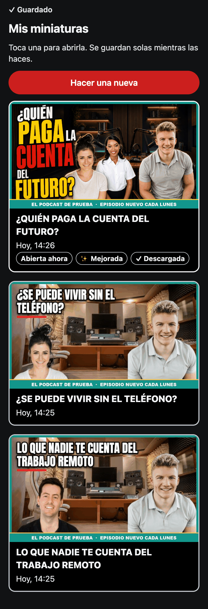
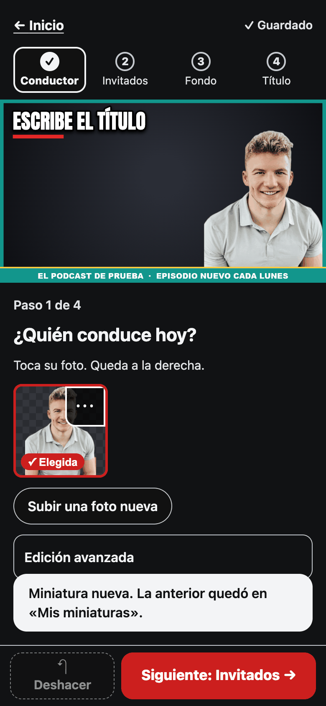
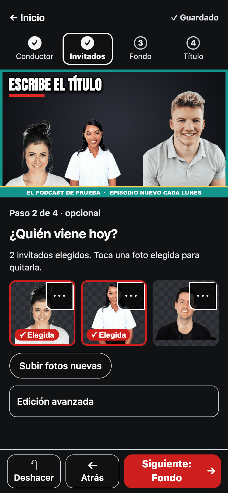
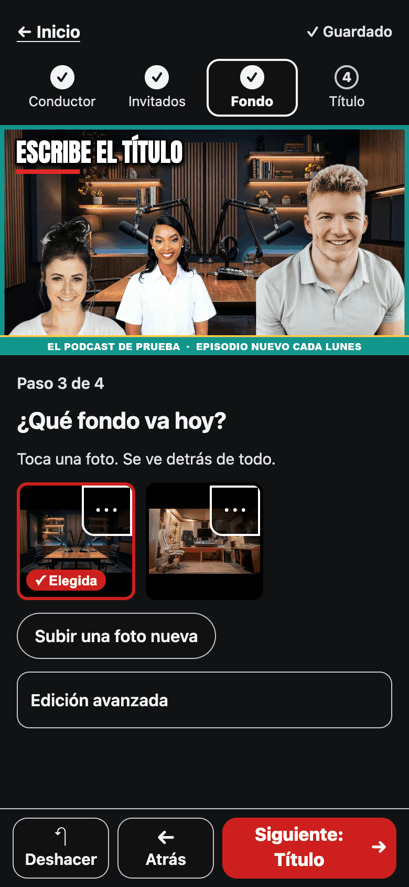
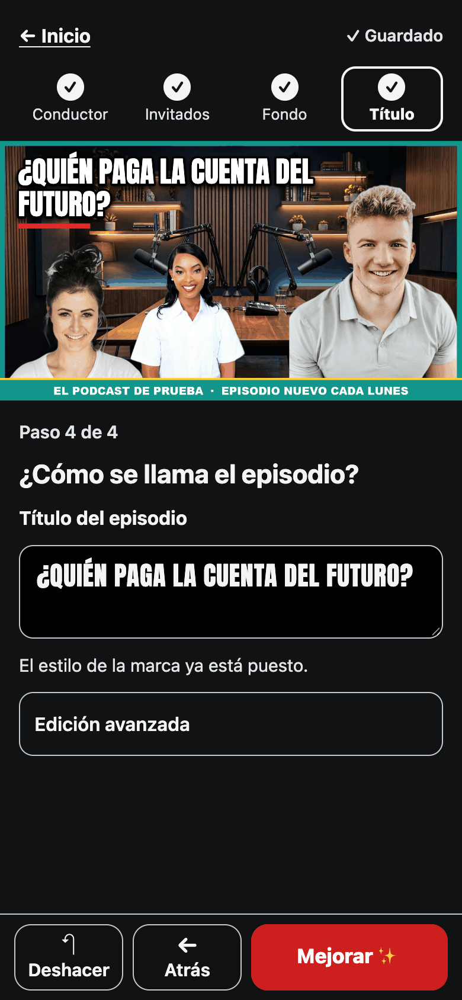
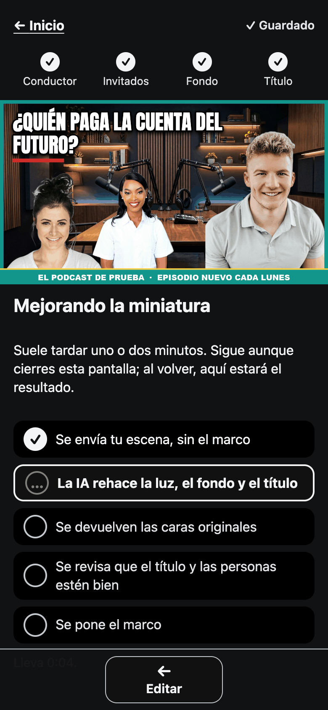

# Thumbnail Studio

🇪🇸 [Leer en español](#es)

**YouTube thumbnails for a show, made in a couple of minutes from a phone.**

## Why it exists

Making the day's thumbnail is a small chore that comes back every day. It is
always the same photos, the same frame and a new title. Thumbnail Studio
**saves that time**: the host fills in four short steps, and most of the work
is already done.

It also gives the thumbnail **a better finish** than a quick collage. An AI
reworks the light, the background and how the title stands out.

And it does that **without losing the show's identity**, because it works by
layers. The parts that make the show recognisable are protected:

- the faces of the host and the guests;
- the show's frame and logo;
- the words of the title (their style may change, the words may not).

Everything else is the AI's to improve. The result has to make people want to
click on a small phone screen, and has to look, at first sight, like an
episode of that show.

It is made for the host of a show who publishes often and makes the thumbnail
on their phone, between other things.

## How it is used

The screenshots below come from a demo installation, with stock photos and a
made-up show, «El podcast de prueba». The app's text is in Spanish.

**1. Home.** «Mis miniaturas» lists the thumbnails made so far. «Hacer una
nueva» starts today's. The frame and the usual host are already in place.

**2. Four guided steps**: host, guests, background and title. Each step asks
one question and changes the preview at the top as you tap.

| Host | Guests | Background | Title |
| --- | --- | --- | --- |
|  |  |  |  |

**3. «Mejorar».** The AI improves the mockup. It takes a minute or two, and the
screen says what is happening at each stage.

**4. Choose.** Your mockup stays at the top and the improved one is below it.
«Usar esta» keeps the improved one, and «Volver atrás» goes back to editing.

**5. Done.** The thumbnail is saved. «Descargar de nuevo» downloads it again at
any time.

## Before and after

The host's mockup, as it was after the four steps:

After «Mejorar». The same people, faces, frame and title words, with new light,
a new background and a new title style:

The original faces are put back onto the result. If that cannot be done
cleanly, or the AI added someone or changed a word of the title, the
improvement is rejected and the host keeps their own thumbnail.

## More

- [How to run it](docs/how-to-run.md): installation, settings and development.
- [Decisions](docs/adr/): why the app works the way it does.
- [Screenshot credits](docs/screenshots/CREDITS.md).

---

# Thumbnail Studio (español)

🇬🇧 [English](#en)

**Miniaturas de YouTube para un programa, hechas en un par de minutos desde el
teléfono.**

## Para qué existe

Hacer la miniatura del día es una tarea pequeña que vuelve todos los días.
Siempre son las mismas fotos, el mismo marco y un título nuevo. Thumbnail
Studio **ahorra ese tiempo**: quien conduce el programa completa cuatro pasos
cortos, y casi todo el trabajo ya está hecho.

Además le da a la miniatura **una mejor terminación** que un collage rápido.
Una IA retoca la luz, el fondo y cómo resalta el título.

Y lo hace **sin perder la identidad del programa**, porque trabaja por capas.
Lo que hace reconocible al programa está protegido:

- las caras de quien conduce y de los invitados;
- el marco y el logo del programa;
- las palabras del título (su estilo puede cambiar, las palabras no).

Todo lo demás lo puede mejorar la IA. El resultado tiene que dar ganas de
hacer clic en la pantalla pequeña de un teléfono, y tiene que verse, a primera
vista, como un episodio de ese programa.

Está pensada para quien conduce un programa que publica seguido y hace la
miniatura en persona, desde el teléfono, entre otras cosas.

## Cómo se usa

Las capturas vienen de una instalación de prueba, con fotos de stock y un
programa inventado, «El podcast de prueba».

**1. Inicio.** «Mis miniaturas» muestra las miniaturas hechas hasta ahora.
«Hacer una nueva» empieza la de hoy. El marco y el conductor de siempre ya
están puestos.

**2. Cuatro pasos guiados**: conductor, invitados, fondo y título. Cada paso
hace una pregunta, y la vista previa de arriba cambia con cada toque.

| Conductor | Invitados | Fondo | Título |
| --- | --- | --- | --- |
|  |  |  |  |

**3. «Mejorar».** La IA mejora la maqueta. Tarda uno o dos minutos, y la
pantalla dice qué está pasando en cada etapa.

**4. Elegir.** Tu maqueta queda arriba y la mejorada debajo. «Usar esta» se
queda con la mejorada, y «Volver atrás» vuelve a la edición.

**5. Lista.** La miniatura queda guardada. «Descargar de nuevo» la vuelve a
descargar cuando haga falta.

## Antes y después

La maqueta, tal como quedó después de los cuatro pasos:

Después de «Mejorar». Las mismas personas, caras, marco y palabras del título,
con luz nueva, fondo nuevo y un estilo nuevo para el título:

Las caras originales se vuelven a poner sobre el resultado. Si eso no se puede
hacer bien, o la IA agregó a alguien o cambió una palabra del título, la mejora
se rechaza y queda la miniatura propia.

## Más

- [Cómo ponerla en marcha](docs/how-to-run.md) (en inglés): instalación,
  ajustes y desarrollo.
- [Decisiones](docs/adr/) (en inglés): por qué la app funciona como funciona.
- [Créditos de las capturas](docs/screenshots/CREDITS.md) (en inglés).
